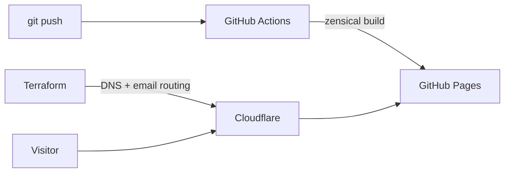

# Hello, world: how this site is built

*2026-11-27*

This is the first post on 4etam.com, and the site itself is my first project here.
Everything about it lives in Git and deploys automatically.

## Architecture



- **Content** — Markdown in the [`4etam.com`](https://github.com/almaty-itrider/4etam.com) repo,
  rendered by [Zensical](https://zensical.org), the successor to Material for MkDocs.
- **CI/CD** — every push to `main` builds the site and deploys it to GitHub Pages.
  Pull requests are built too, so a broken page never reaches production.
- **DNS** — managed in Cloudflare with Terraform in the [`infra`](https://github.com/almaty-itrider/infra) repo.
  The domain is verified in GitHub to protect against subdomain takeover.
- **Email** — `me@4etam.com` is a Cloudflare Email Routing rule that forwards to my inbox.
  No mail server to run.

## Why not a .kz domain?

My first choice was 4etam.kz. But the .KZ registry rules require a site on a .kz domain to be
hosted on servers physically located in Kazakhstan, and its DNS records must point to Kazakh IP
addresses. GitHub Pages runs on a global CDN, so pointing 4etam.kz at it would break those rules
and risk the domain being suspended.

So the site lives on **4etam.com**, which has no hosting restrictions, and 4etam.kz will simply
redirect here.

## What went wrong (and what I learned)

The first `terraform apply` failed: Cloudflare answered with a mix of `429 Too Many Requests`
and `401 Authentication error`. Terraform reported that nothing was created, so the state stayed
empty.

But checking the zone through the API showed that **all 11 DNS records had actually been
created** — the requests succeeded, the responses didn't make it back. Re-running `apply` would
have tried to create duplicates.

Instead of deleting the records by hand, I brought them under Terraform with
[`import` blocks](https://developer.hashicorp.com/terraform/language/import) (Terraform 1.5+):

```hcl
import {
  to = cloudflare_dns_record.apex_a["185.199.108.153"]
  id = "<zone_id>/<record_id>"
}
```

The next `plan` showed only the remaining resources to create. Takeaways:

- An API error doesn't always mean the change didn't happen — check the real state.
- `terraform plan -out tfplan` + `terraform apply tfplan` applies exactly what you reviewed.
- `-parallelism=2` is a simple fix for API rate limits.
- Not everything has to be in Terraform: enabling Email Routing and verifying the destination
  inbox are one-time manual steps, so only the forwarding rule is managed as code.

## What's next

The next project is real infrastructure work rather than a website. Stay tuned — or follow along
on [GitHub](https://github.com/almaty-itrider).
