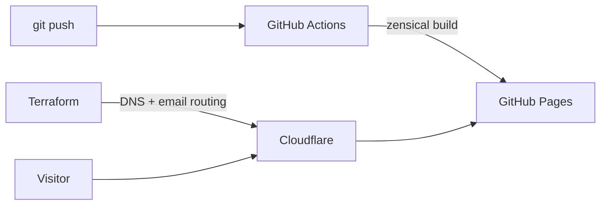

# Hello, world: how this site is built

*2026-11-27*

This is the first post on 4etam.com, and the site itself is my first project here.
Everything about it lives in Git and deploys automatically.

## Architecture

- **Content** — Markdown in the [`4etam.com`](https://github.com/almaty-itrider/4etam.com) repo,
  rendered by [Zensical](https://zensical.org), the successor to Material for MkDocs.
- **CI/CD** — every push to `main` builds the site and deploys it to GitHub Pages.
  Pull requests are built too, so a broken page never reaches production.
- **DNS** — managed in Cloudflare with Terraform in the [`infra`](https://github.com/almaty-itrider/infra) repo.
  The domain is verified in GitHub to protect against subdomain takeover.
- **Email** — `me@4etam.com` is a Cloudflare Email Routing rule that forwards to my inbox.
  No mail server to run.

## Why not a .kz domain?

TODO: a short paragraph about the .KZ rule that sites must be hosted on servers in Kazakhstan,
and why 4etam.kz now just redirects here.

## What's next

TODO: next project / next post.
