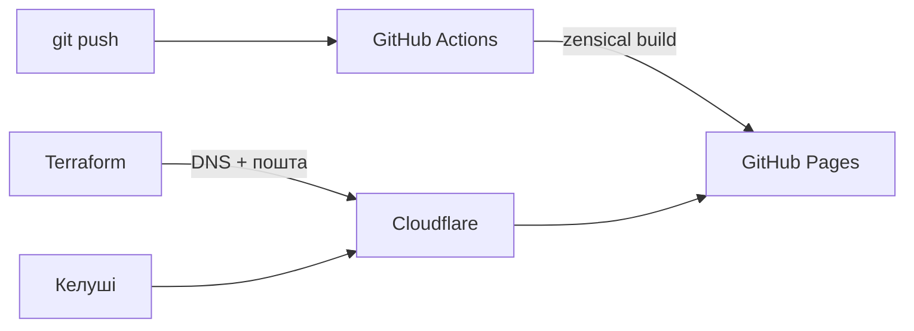

# Hello, world: бұл сайт қалай жасалған

*2026-11-27*

Бұл 4etam.com сайтындағы алғашқы жазба, ал сайттың өзі — мұндағы алғашқы жобам.
Оған қатысты барлық нәрсе Git-те сақталады және автоматты түрде жарияланады.

## Архитектура



- **Мазмұн** — [`4etam.com`](https://github.com/almaty-itrider/4etam.com) репозиторийіндегі Markdown,
  сайтты Material for MkDocs-тың ізбасары [Zensical](https://zensical.org) жинайды.
- **CI/CD** — `main` тармағына жасалған әр push сайтты жинап, GitHub Pages-ке жариялайды.
  Pull request-тер де жиналады, сондықтан бұзылған бет продакшнға түспейді.
- **DNS** — Cloudflare-де [`infra`](https://github.com/almaty-itrider/infra) репозиторийіндегі Terraform арқылы басқарылады.
  Домен GitHub-та расталған, бұл ішкі домендерді басып алудан қорғайды.
- **Пошта** — `me@4etam.com` — хаттарды менің пошта жәшігіме жіберетін Cloudflare Email Routing ережесі.
  Жеке пошта серверінің қажеті жоқ.

## Неге .kz домені емес?

Алғашында 4etam.kz-ті таңдағым келді. Бірақ .KZ аймағының ережелері бойынша мұндай домендегі сайт
Қазақстан аумағындағы серверлерде орналасуы керек, ал оның DNS жазбалары қазақстандық IP мекенжайларға
бағытталуы тиіс. GitHub Pages жаһандық CDN-де жұмыс істейді, сондықтан 4etam.kz-ті оған бағыттау
ережелерді бұзып, доменнің бұғатталу қаупін тудырар еді.

Сондықтан сайт мұндай шектеулері жоқ **4etam.com** доменінде орналасқан, ал 4etam.kz жай ғана
осында бағыттайтын болады.

## Не дұрыс болмады (және мен неге үйрендім)

Алғашқы `terraform apply` сәтсіз аяқталды: Cloudflare аралас `429 Too Many Requests`
және `401 Authentication error` жауаптарын қайтарды. Terraform ештеңе жасалмағанын хабарлады, state бос қалды.

Бірақ аймақты API арқылы тексергенде **барлық 11 DNS жазбасы шын мәнінде жасалғаны** анықталды:
сұраулар орындалған, ал жауаптар Terraform-ға жетпеген. `apply`-ды қайта іске қосу көшірмелер жасауға тырысар еді.

Жазбаларды қолмен жоюдың орнына, мен оларды
[`import` блоктары](https://developer.hashicorp.com/terraform/language/import) арқылы Terraform басқаруына алдым (Terraform 1.5+):

```hcl
import {
  to = cloudflare_dns_record.apex_a["185.199.108.153"]
  id = "<zone_id>/<record_id>"
}
```

Келесі `plan` тек қалған ресурстарды көрсетті. Қорытындылар:

- API қатесі өзгерістің болмағанын әрдайым білдірмейді — нақты күйін тексер.
- `terraform plan -out tfplan` + `terraform apply tfplan` тексерген нәрсеңді дәл сол күйінде қолданады.
- `-parallelism=2` — API лимиттеріне қарсы қарапайым шешім.
- Бәрі Terraform-да болуы міндетті емес: Email Routing-ті қосу және пошта жәшігін растау — бір реттік қолмен
  орындалатын қадамдар, сондықтан кодпен тек жіберу ережесі басқарылады.

## Әрі қарай не болады

Келесі жоба — сайт емес, нағыз инфрақұрылымдық жұмыс. Жаңалықтарды осы жерден
немесе [GitHub](https://github.com/almaty-itrider)-тан бақылаңыз.
