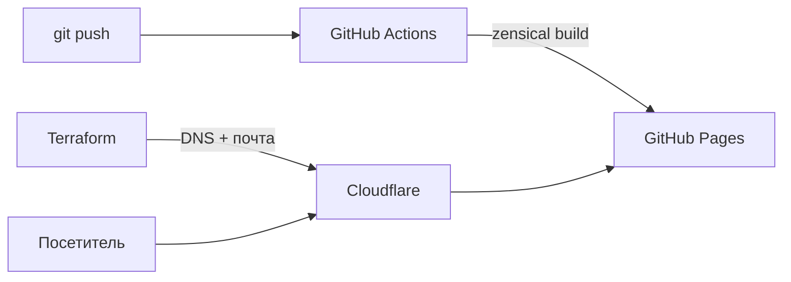

# Hello, world: как устроен этот сайт

*2026-11-27*

Это первый пост на 4etam.com, а сам сайт — мой первый проект здесь.
Всё, что к нему относится, хранится в Git и разворачивается автоматически.

## Архитектура



- **Контент** — Markdown в репозитории [`4etam.com`](https://github.com/almaty-itrider/4etam.com),
  сайт собирает [Zensical](https://zensical.org), преемник Material for MkDocs.
- **CI/CD** — каждый пуш в `main` собирает сайт и публикует его на GitHub Pages.
  Pull request'ы тоже собираются, так что сломанная страница не попадёт в продакшн.
- **DNS** — управляется в Cloudflare через Terraform в репозитории [`infra`](https://github.com/almaty-itrider/infra).
  Домен подтверждён в GitHub, это защищает от захвата поддоменов.
- **Почта** — `me@4etam.com` — это правило Cloudflare Email Routing, которое пересылает письма в мой ящик.
  Свой почтовый сервер не нужен.

## Почему не домен .kz?

Сначала я хотел 4etam.kz. Но по правилам зоны .KZ сайт на таком домене должен размещаться
на серверах, физически находящихся в Казахстане, а его DNS-записи должны указывать на казахстанские
IP-адреса. GitHub Pages работает на глобальном CDN, так что направить на него 4etam.kz означало бы
нарушить правила и рисковать блокировкой домена.

Поэтому сайт живёт на **4etam.com**, где таких ограничений нет, а 4etam.kz будет просто
перенаправлять сюда.

## Что пошло не так (и чему я научился)

Первый `terraform apply` упал: Cloudflare отвечал вперемешку `429 Too Many Requests`
и `401 Authentication error`. Terraform сообщил, что ничего не создано, и state остался пустым.

Но проверка зоны через API показала, что **все 11 DNS-записей на самом деле создались**:
запросы прошли, а ответы до Terraform не дошли. Повторный `apply` попытался бы создать дубликаты.

Вместо того чтобы удалять записи вручную, я забрал их под управление Terraform через
[блоки `import`](https://developer.hashicorp.com/terraform/language/import) (Terraform 1.5+):

```hcl
import {
  to = cloudflare_dns_record.apex_a["185.199.108.153"]
  id = "<zone_id>/<record_id>"
}
```

Следующий `plan` показал только оставшиеся ресурсы. Выводы:

- Ошибка API не всегда значит, что изменение не произошло — проверяй реальное состояние.
- `terraform plan -out tfplan` + `terraform apply tfplan` применяет ровно то, что ты проверил.
- `-parallelism=2` — простое решение против лимитов API.
- Не всё обязано быть в Terraform: включение Email Routing и подтверждение ящика — разовые ручные шаги,
  поэтому кодом управляется только правило пересылки.

## Что дальше

Следующий проект — настоящая инфраструктурная работа, а не сайт. Следите за обновлениями
здесь или на [GitHub](https://github.com/almaty-itrider).
